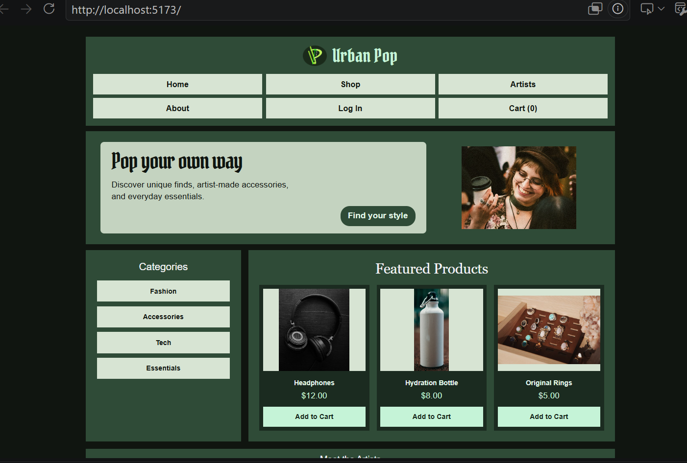
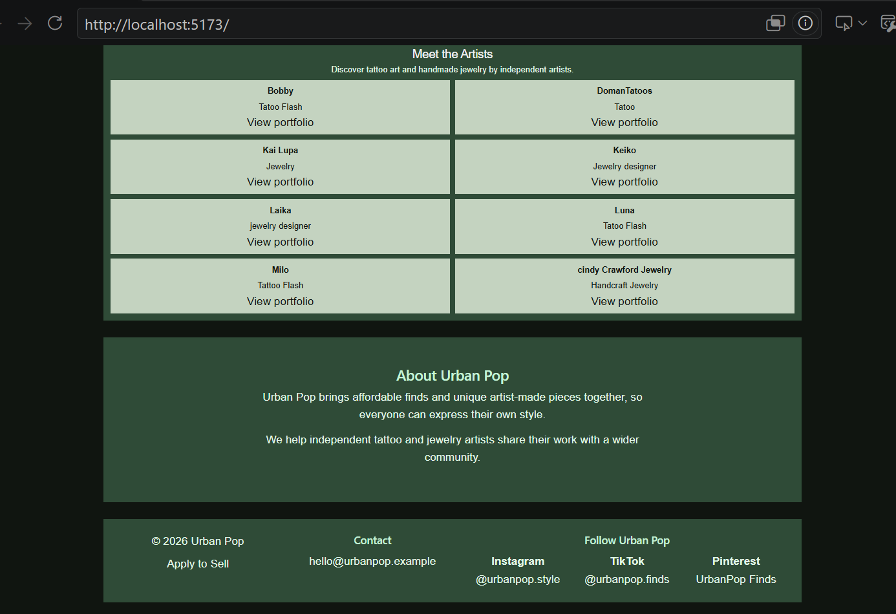

# UrbanPop Online Marketplace

UrbanPop is a portfolio project for an affordable online store featuring everyday products and independent artists. Customers can browse products, create an account, and place demo orders. Artists can apply to join the marketplace.

The physical store dashboard is a separate UrbanPop project.

## Features

- Product catalog connected to the Django backend
- Product category filters
- Shopping cart
- Customer signup, login, and password reset (reset emails print to the Django terminal during local development)
- Demo orders for guests and signed-in customers
- Inventory updates when an order is placed
- Artist applications reviewed in Django admin
- Responsive storefront layout

## Technologies

- React and Vite
- Django and Django REST Framework
- SQLite
- HTML and CSS

## Project folders

- `UrbanPopFront` — React storefront
- `UrbanPopBack` — Django backend and admin

## Run locally

You’ll need Python and Node.js installed. Start the backend and frontend in separate terminals.

### Backend

In the first terminal, from the main UrbanPop folder, run these commands one at a time:

1. `cd UrbanPopBack`
2. `py -m venv .venv`
3. `.\.venv\Scripts\Activate.ps1`
4. `py -m pip install django djangorestframework django-cors-headers Pillow`
5. `py manage.py migrate`
6. `py manage.py createsuperuser`
7. `py manage.py runserver`

The Django admin is at `http://127.0.0.1:8000/admin/`. A fresh database has no products yet, so add products through Django admin.

### Frontend

Open a second terminal at the main UrbanPop folder and run:

1. `cd UrbanPopFront`
2. `npm install`
3. `npm run dev`

Open the local address Vite shows in the terminal, usually `http://localhost:5173`.

## Tests

The Django backend has 7 automated tests. To run them, open a terminal in `UrbanPopBack`, activate `.venv`, and run `py manage.py test`.

## Demo information

Checkout is for demonstration purposes and does not process real payments. The Django development secret key is for local use only.

## Screenshots

